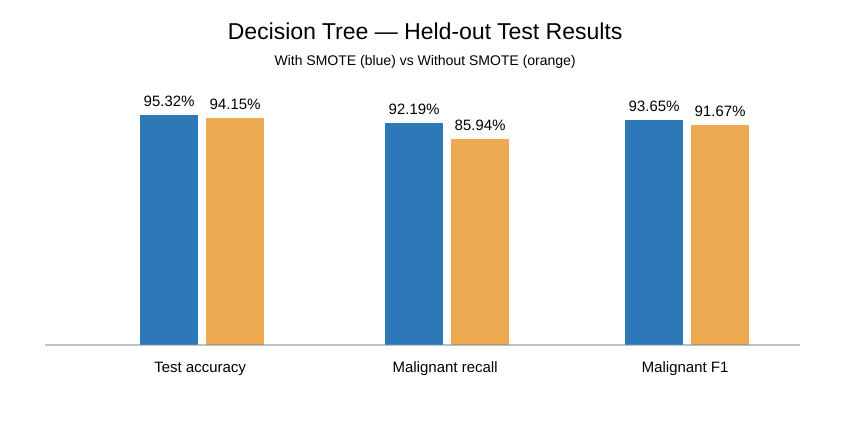
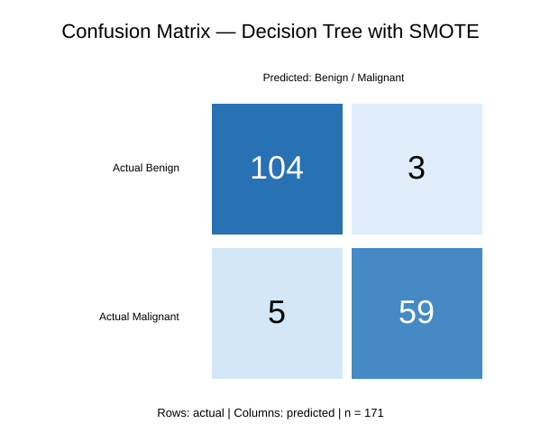

# Breast Cancer Classification — Leakage-Aware Decision Tree

**Python | Scikit-learn | Imbalanced-learn | SMOTE | GridSearchCV | Jupyter**

An educational **binary classification** project distinguishing benign (B) from malignant (M) labels using ten numerical features. This project preserves the original Decision Tree experiment and adds an improved leakage-aware evaluation comparing training with and without SMOTE.

> **Important:** This project is not a medical device, screening system or clinical diagnostic tool. Reported performance is dataset-specific and is not validated for healthcare decisions.

## 1. Project Highlights

| Item | Details |
|---|---|
| Task | Benign vs malignant binary classification |
| Dataset | 569 records (357 benign, 212 malignant) |
| Features | 10 selected numerical tumor-related measurements |
| Algorithm | Decision Tree |
| Validation | Stratified 70/30 train/test split, 5-fold CV |
| Tuning | GridSearchCV, optimizing malignant recall |
| Comparison | With SMOTE vs without SMOTE |
| Best recorded test accuracy | **95.32%** (with SMOTE) |
| Best recorded malignant recall | **92.19%** (with SMOTE) |
| Missed malignant cases | **5 of 64** on the held-out split |

## 2. Dataset and Features

The input CSV is a Wisconsin Diagnostic Breast Cancer-style dataset with 569 rows and 33 columns, including `id`, target `diagnosis`, and the empty `Unnamed: 32` column. The identifier and empty column are excluded from the features. The target is mapped **B=0, M=1**.

| Label | Count | Percentage |
|---|---:|---:|
| Benign | 357 | 62.74% |
| Malignant | 212 | 37.26% |

The selected features are:

`concave points_mean`, `radius_worst`, `perimeter_worst`, `area_worst`, `texture_worst`, `concave points_worst`, `perimeter_mean`, `area_mean`, `radius_mean`, `concavity_mean`.

**Dataset availability:** `data/data.csv` is deliberately **not uploaded to GitHub** while provenance and redistribution licensing are being checked. Place a lawfully obtained copy there to reproduce the experiment.

## 3. Original Notebook and Recorded Results

The original notebook `Untitled32.ipynb` explores class balance, feature distributions, skewness, PowerTransformer, StandardScaler, SMOTE, Decision Tree tuning, GridSearchCV, confusion matrix, feature importance and pickle serialization.

Its recorded results were:

- Training accuracy: **99.40%**
- Test accuracy: **95.35%**
- GridSearchCV best score: **0.9519**
- Incorrect test predictions: **10**, including **7 missed malignant cases**

**Limitations of the original workflow:** It fitted preprocessing and performed SMOTE before the train/test split, creating data-leakage risks. Also, a separately trained tree and the grid-selected model were used inconsistently. These original scores are reported for historical context, not as leakage-free generalization estimates.

## 4. Corrected Leakage-Aware Pipeline

```text
Raw CSV (569 records)
       |
       v
Select 10 features + encode diagnosis
       |
       v
Stratified train/test split (70/30)
       |
       v
GridSearchCV on training set only
       |
       +-- PowerTransformer (fit inside CV fold)
       +-- StandardScaler (fit inside CV fold)
       +-- SMOTE (training fold only, optional)
       +-- DecisionTreeClassifier
       |
       v
Refit best pipeline on training set
       |
       v
Predict on untouched test set (171 records)
       |
       v
Accuracy, malignant recall, F1, confusion matrix
```

An `imblearn.pipeline.Pipeline` handles transformations and SMOTE **inside** cross-validation. Both experiments use the same stratified split, grid and random seed. Model selection maximizes malignant recall; overall accuracy and precision are still relevant.

## 5. Corrected Evaluation and Charts

| Metric | With SMOTE | Without SMOTE |
|---|---:|---:|
| Test accuracy | **95.32%** | 94.15% |
| Balanced accuracy | **94.69%** | 92.50% |
| Malignant recall | **92.19%** | 85.94% |
| Malignant F1 | **93.65%** | 91.67% |
| Missed malignant samples | **5** | 9 |

### Model Comparison Chart



### Confusion Matrix — With SMOTE



| Actual / Predicted | Benign | Malignant |
|---|---:|---:|
| Benign | 104 | 3 |
| Malignant | 5 | 59 |

The model incorrectly labeled **five malignant samples as benign** in this held-out set. The comparison is based on a single 171-row test partition, not an independent clinical study. Cross-validation and external generalization may differ.

Full machine-readable results are in `results/model_comparison.json` and `results/model_comparison.csv`.

## 6. Repository Organization

```text
breast-cancer-/
├── README.md
├── requirements.txt
├── .gitignore
├── Untitled32.ipynb                 # original notebook retained
├── src/
│   └── evaluate.py
├── notebooks/
│   └── breast_cancer_leakage_aware.ipynb
└── results/
    ├── model_comparison.json
    ├── model_comparison.csv
    ├── model_comparison_chart.svg
    └── confusion_matrix_with_smote.svg
```

The original notebook remains untouched; the separate corrected notebook can be run after supplying the local CSV.

## 7. Installation (Windows)

Clone the repository and set up a virtual environment:

```bat
git clone https://github.com/syblejan/breast-cancer-.git
cd breast-cancer-
python -m venv .venv
.venv\Scripts\activate
python -m pip install -r requirements.txt
```

Place your licensed dataset at `data/data.csv`, then run:

```bat
python src/evaluate.py
```

This regenerates the result CSV and JSON files. To open the corrected notebook, launch Jupyter from the project root and open `notebooks/breast_cancer_leakage_aware.ipynb`.

## 8. Technology Stack

- **Pandas / NumPy:** data handling
- **Scikit-learn:** Decision Tree, transformations, cross-validation, tuning, metrics
- **Imbalanced-learn:** SMOTE inside the training pipeline
- **Jupyter Notebook:** reproducible interactive evaluation
- **SVG charts:** visual result summaries

## 9. Limitations and Future Improvements

- Dataset source and redistribution licensing need documentation.
- No external dataset or clinical validation.
- A single held-out split and small malignant test sample limit uncertainty estimates.
- The ten selected features came from the original experiment; nested feature selection has not been performed.
- Repeated model decisions using the same test set may bias future comparisons.
- Potential improvements include repeated/nested CV, calibration, specificity/sensitivity studies, regression tests, and independent cohorts.

## 10. Author

**Syble Jan** — BS Computer Science student, aspiring AI/ML Engineer.

[GitHub Profile](https://github.com/syblejan)

---

**Status:** Educational leakage-aware model comparison complete; GitHub project documentation and visualizations published. **Not medically validated.**
